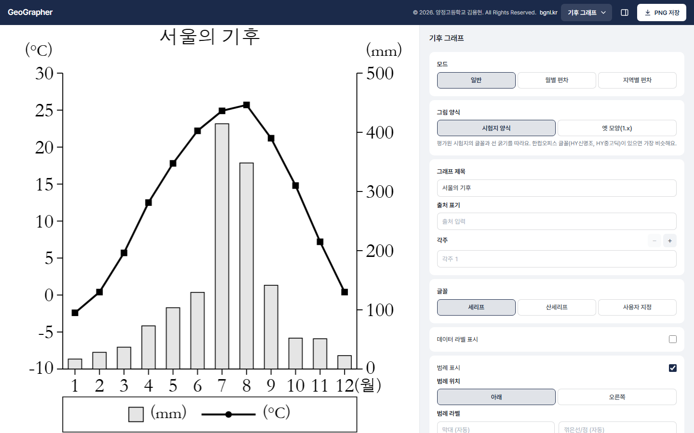
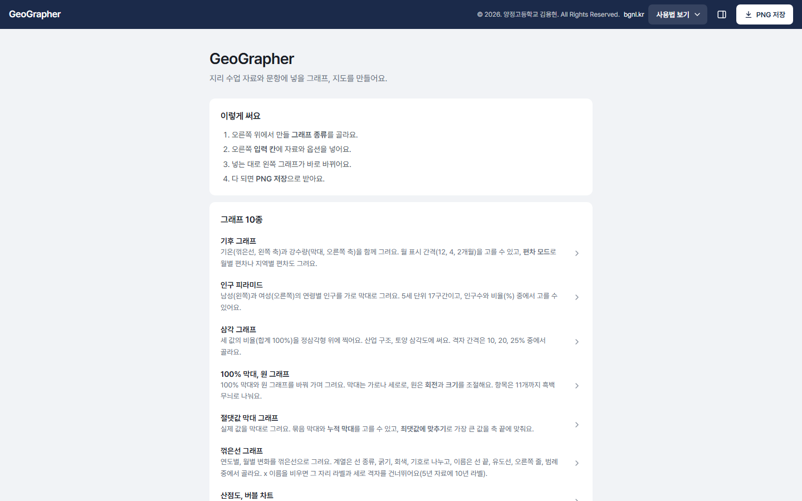

# GeoGrapher (지오그래퍼)

지리 수업 자료와 시험 문항에 넣을 그래프와 통계 지도를 만드는 웹 도구입니다. 오른쪽 입력 칸에 자료를 넣으면 왼쪽 그림이 바로 바뀌고, 다 되면 PNG로 받습니다. 기본 모양은 수능과 모의고사 시험지처럼 흑백 세리프체로 그려서, 문항을 만드는 지리 선생님이 바로 쓸 수 있습니다.

바로가기: https://geographer.bgnl.kr



## 할 수 있는 일

### 그래프 10종

- **기후 그래프**: 기온(꺾은선, 왼쪽 축)과 강수량(막대, 오른쪽 축)을 함께 그립니다. 월별 편차, 지역별 편차 모드도 있습니다.
- **인구 피라미드**: 남녀 연령별 인구를 5세 단위 17구간 가로 막대로 그립니다. 인구수와 비율(%) 중에서 고릅니다.
- **삼각 그래프**: 합이 100%인 세 값을 정삼각형 위에 찍습니다. 산업 구조, 토양 삼각도에 씁니다.
- **100% 막대, 원 그래프**: 100% 막대(가로, 세로)와 원 그래프를 바꿔 가며 그립니다. 항목은 11개까지 흑백 무늬로 나눕니다.
- **절댓값 막대 그래프**: 묶음 막대와 누적 막대를 그리고, 가장 큰 값을 축 끝에 맞출 수 있습니다.
- **꺾은선 그래프**: 계열을 선 종류, 굵기, 회색, 기호로 나누고, 이름은 선 끝, 유도선, 오른쪽 줄, 범례 중에서 고릅니다.
- **산점도, 버블 차트**: x, y 값과 셋째 값(버블 크기)을 찍습니다. (0, 0) 십자선으로 네 칸을 나누는 편차 산점도도 됩니다.
- **하이서그래프**: 12개월 기온과 강수량을 닫힌 선으로 잇고, 5개 지역까지 비교합니다.
- **정육면체 그래프**: 정육면체 꼭짓점에 자료를 놓아 세 기준으로 나눕니다.
- **방사형 그래프**: 3~12개 축에 값을 찍어 다각형으로 잇고, 5개 계열까지 비교합니다.

### 통계 지도 4종

한국 행정구역(시도, 시군구, 광역시를 하나로 합친 시군구)과 세계 나라(대서양 중심, 태평양 중심, 밀러 도법) 위에 그립니다.

- **단계구분도**: 지역을 3~7단계 색이나 무늬로 칠합니다. 지도를 눌러 칠하고, 오른쪽 클릭으로 그 지역 등급을 집습니다.
- **도형표현도**: 지역 가운데에 원 그래프나 막대를 올립니다. 크기는 값에 비례하거나 같게 하고, 겹치면 끌어서 옮깁니다.
- **등치선도**: 지역 값으로 등치선을 그립니다. 간격, 주곡선과 간곡선, 색 채우기를 정합니다.
- **유선도**: 지역이나 나라 사이의 이동, 물류, 무역을 화살표로 그립니다. 지도를 눌러 출발지와 도착지를 정하거나 CSV로 한꺼번에 넣고, 선 굵기는 값에 비례합니다.

### 모든 그림에 있는 기능

- **그림 양식**: 기본인 「시험지 양식」은 평가원 시험지에서 잰 글꼴과 선 굵기를 따릅니다. 예전 그림이 필요하면 「옛 모양(1.x)」을 고릅니다. 축이 있는 그래프는 눈금 방향도 고릅니다.
- **제목, 출처, 각주**: 입력 칸에 적으면 그림에 바로 들어갑니다. 산점도와 꺾은선은 출처를 마지막 각주 줄에 넣을 수 있습니다.
- **글꼴**: 세리프(기본), 산세리프, 컴퓨터에 깔린 글꼴 이름을 직접 적는 사용자 지정 중에서 고릅니다.
- **데이터 라벨과 범례**: 값을 점이나 막대 옆에 적고, 범례는 아래나 오른쪽에 둡니다.
- **CSV 불러오기**: 기후 그래프, 인구 피라미드, 삼각 그래프, 하이서그래프, 유선도는 CSV 파일로 자료를 한 번에 넣습니다.
- **PNG 저장**: 시험 출제용(800×600)이나 원하는 크기로, 1배에서 3배까지 키워 받습니다.



## 쓰는 기술

- React 19, TypeScript, Vite로 만든 정적 웹앱입니다. 서버가 없고 입력한 자료는 어디에도 보내지 않습니다.
- 그래프는 같은 사람이 만든 [csat-chart.js](https://github.com/yhk1m/csat-chart.js) 라이브러리(npm `csat-chart.js`)로 Canvas에 그립니다. 그래프 모양을 고칠 때는 이 라이브러리를 고친 뒤 버전을 올려 받습니다.
- 지도는 d3-geo(밀러 도법은 d3-geo-projection), 등치선은 d3-contour로 SVG에 그립니다.
- 머리띠의 방문자 수는 Google Apps Script(`apps-script/viewCounter.gs`)와 스프레드시트로 셉니다.
- 배포는 Vercel이며 `master` 가지에 올리면 자동으로 배포됩니다.

## 실행하기

```
npm install
npm run dev       # 개발 서버
npm run build     # 타입 검사(tsc -b) 후 dist/ 에 배포용 파일 만들기
npm run preview   # 만든 파일 미리 보기
npm run lint      # ESLint 검사
```

따로 넣을 환경 변수는 없습니다. 테스트 틀은 없고 `npm run build`의 타입 검사로 확인합니다.

## 파일 구성

```
index.html
src/
  main.tsx, App.tsx          시작점과 화면 상태
  data/types.ts              그림 종류별 자료 모양과 기본값
  graphs/renderGraph.ts      csat-chart.js 호출 (화면과 내보내기 공용)
  canvas/export.ts           PNG 내보내기와 파일 이름
  components/
    Header.tsx               머리띠, 그림 종류 메뉴, 방문자 수
    DataDrawer.tsx           오른쪽 입력 칸 (공통 옵션)
    *Input.tsx               그래프 종류별 입력 폼
    GraphCanvas.tsx          그래프 그리는 캔버스
    ExportModal.tsx          PNG 저장 창
    GuidePage.tsx            사용법 화면
    AnnouncementModal.tsx    업데이트 알림 창
    maps/                    단계구분도, 도형표현도, 등치선도, 유선도와 도법
    ui/Select.tsx            고르기 칸
  styles/                    공용 화면 모양
public/
  geo/                       시도, 시군구, 광역시 통합 시군구, 세계 나라 경계 (GeoJSON)
  fonts/                     Pretendard 글꼴과 라이선스
apps-script/viewCounter.gs   방문자 수 Apps Script
docs/superpowers/            꺾은선 그래프 설계와 구현 계획
GeoGrapher_Planning.md       처음 기획서
GeoGrapher_MapModule_Planning.md  지도 모듈 기획서
```

## 자료 출처

- 한국 행정구역 경계: 통계청 SGIS 등 공개 행정구역 경계를 가공했습니다. 필드와 만드는 방법은 `public/geo/README.txt`에 있습니다.
- 글꼴: Pretendard (SIL Open Font License 1.1, `public/fonts/OFL-Pretendard.txt`)

## 만든 사람

양정고등학교 지리교사 김용현  
문의: bgnlkim@gmail.com
